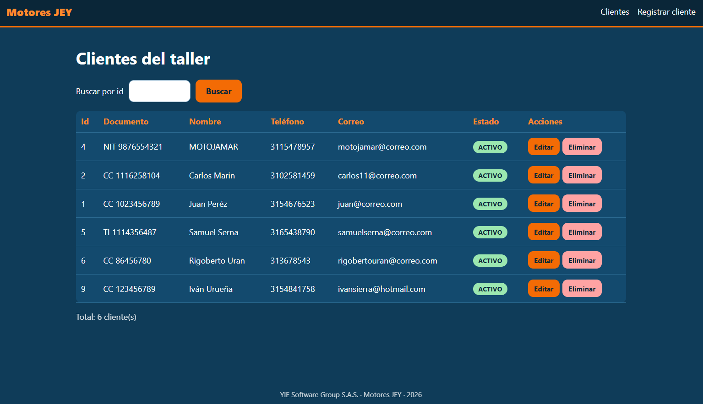
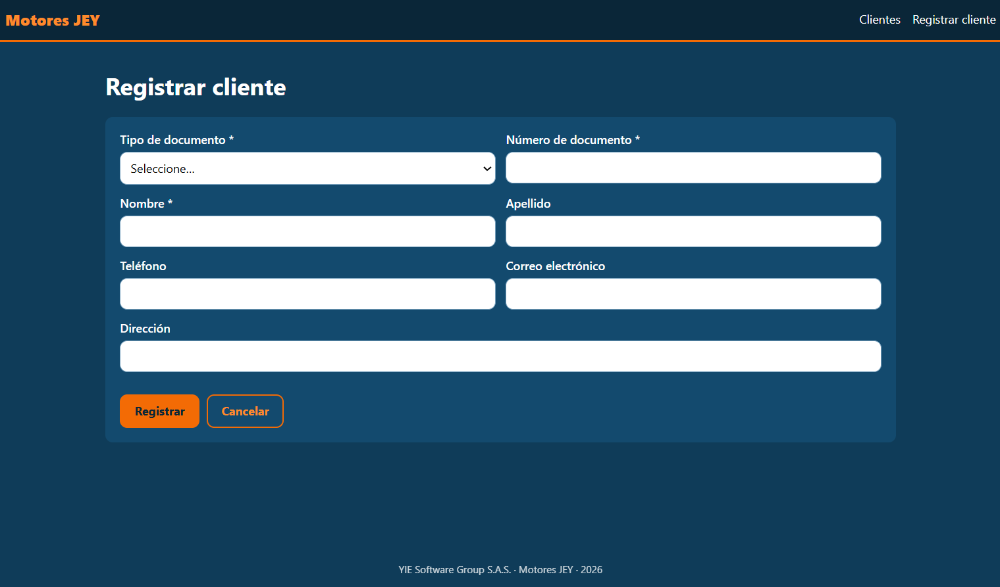
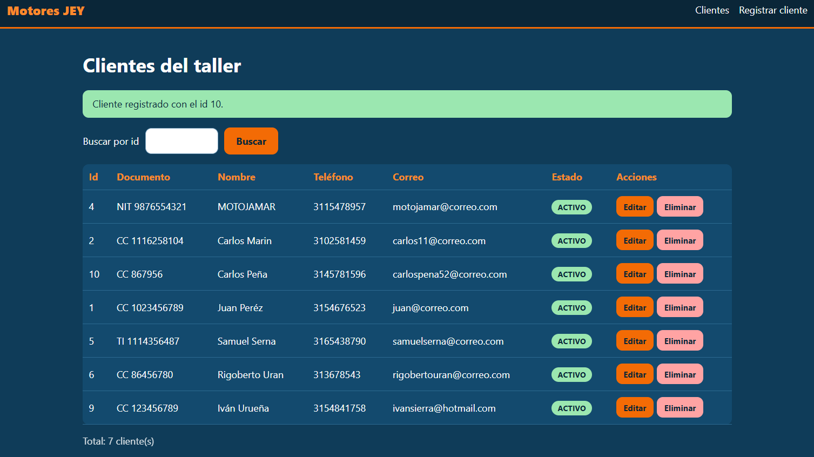
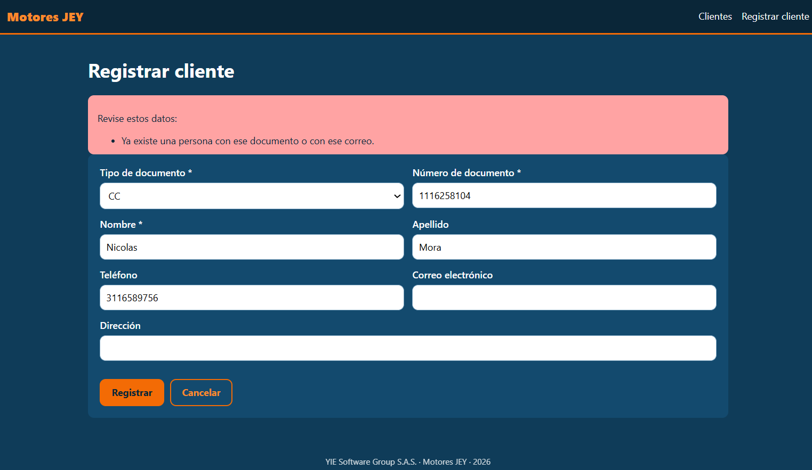
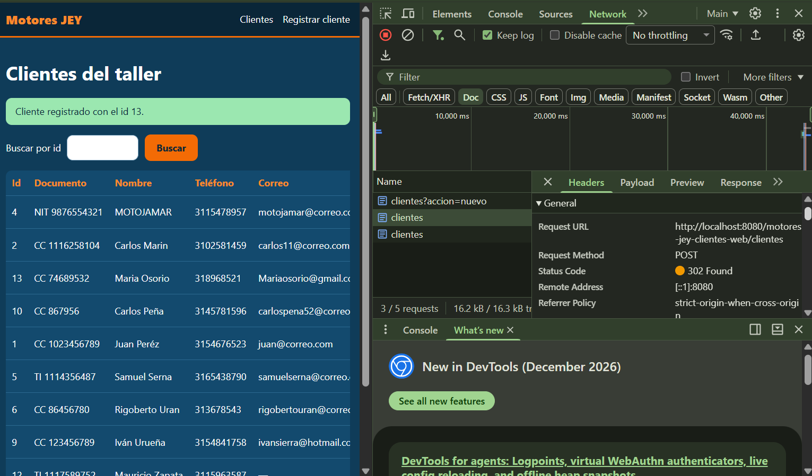
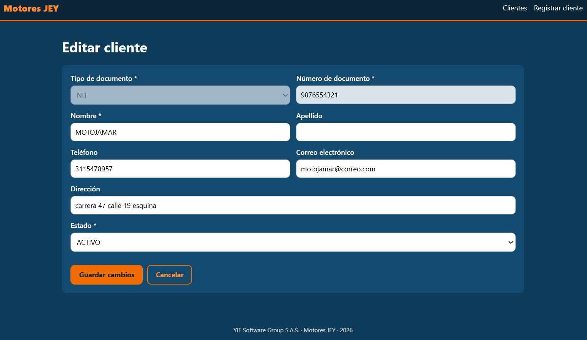
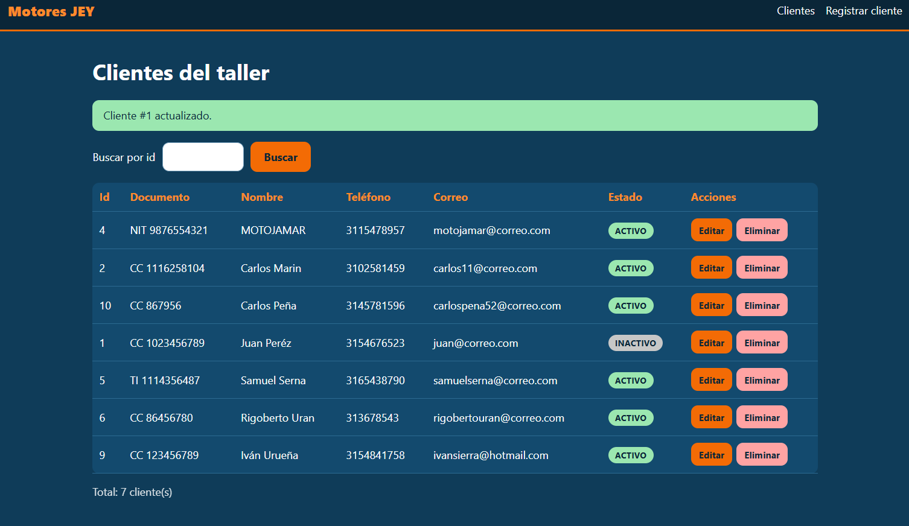
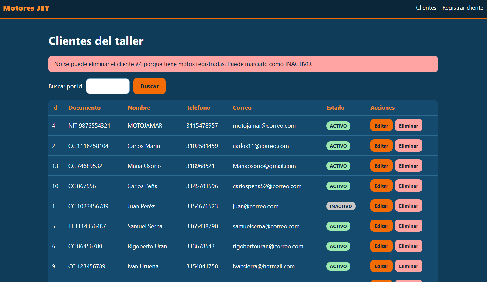
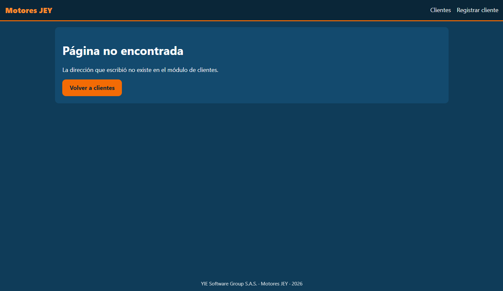
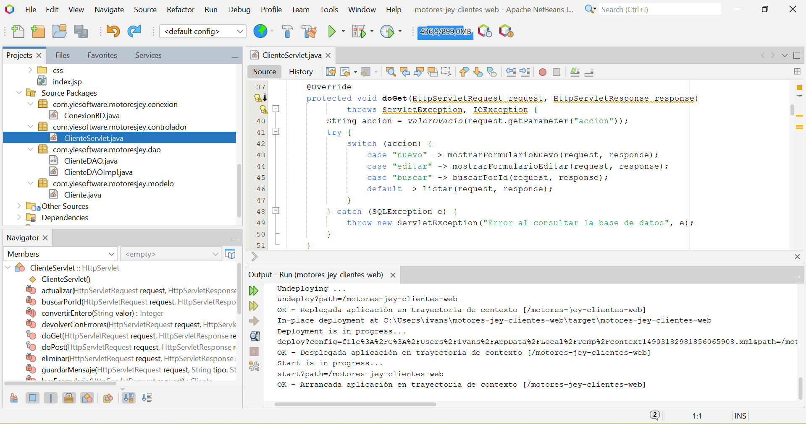

# Motores JEY · Módulo Gestión de Clientes (Web con Servlets y JSP)

Módulo web del sistema de gestión **Motores JEY**, desarrollado por **YIE Software Group S.A.S.** para el taller de motocicletas Motores Jey.
Permite **registrar, consultar, actualizar, inactivar y eliminar clientes** desde el navegador, usando Servlets, JSP y una base de datos MySQL por medio de JDBC.

- **Aprendiz:** Iván Sierra
- **Programa:** Análisis y Desarrollo de Software (SENA) · Ficha 3336046
- **Evidencia:** GA7-220501096-AA2-EV02 · Módulos de software codificados y probados

## Requisitos que cubre

Este módulo implementa el **Módulo 2: Clientes** de la propuesta técnica del proyecto:

- **RF-03 · Registro y CRUD de Clientes** (prioridad alta): crear, consultar, actualizar e inactivar perfiles de clientes, validando la unicidad del número de identificación.
  - **Crear:** formulario de registro enviado por POST.
  - **Consultar:** lista de clientes y búsqueda por id (GET).
  - **Actualizar e inactivar:** formulario de edición con selector de estado ACTIVO / INACTIVO (GET + POST).
  - **Eliminar:** formulario POST con confirmación; se bloquea si el cliente tiene motos registradas.
  - La unicidad del documento y del correo la garantizan los índices únicos de la base de datos (`uq_personas_documento` y `email_UNIQUE`), y la aplicación muestra un mensaje claro si se repiten.

### Trazabilidad con los artefactos anteriores

| Artefacto previo | Cómo se refleja en este módulo |
|---|---|
| Propuesta técnica (GA2-220501094-AA4-EV01): RF-03 | Las operaciones de crear, consultar, actualizar, inactivar y eliminar, y la unicidad del documento |
| Propuesta técnica: arquitectura de tres capas | Vista (JSP) → Controlador (`ClienteServlet`) → Datos (`ClienteDAO` + MySQL) |
| Diagrama de clases | Clase `Cliente` con los atributos de `personas` y `clientes`; interfaz `ClienteDAO` |
| Modelo relacional y `script_final_motores_jey.sql` | Tablas `personas` y `clientes`; índices únicos de documento y correo; llave foránea de `motos` que impide eliminar un cliente con motos |
| Casos de uso e historias de usuario del administrador | El administrador es quien registra y gestiona los clientes desde estas pantallas |
| Prototipo en Figma y diseño front-end (GA6-220501096-AA4-EV03) | Colores `#0F3C59` y `#F36B05`, clases CSS con nomenclatura BEM, etiquetas `<label>` y contraste accesible |
| Módulo JDBC (GA7-220501096-AA2-EV01) | `ConexionBD`, `Cliente`, `ClienteDAO` y `ClienteDAOImpl` reutilizados |

## Tecnologías

| Tecnología | Versión | Uso |
|---|---|---|
| Java (JDK) | 26 | Lenguaje de programación |
| Jakarta Servlet | 6.1 | Controlador web (`ClienteServlet`) |
| Jakarta Server Pages (JSP) | 4.0 | Vistas |
| JSTL | 3.0 | Etiquetas `c:` y `fn:` en las JSP |
| Apache Tomcat | 11 | Servidor de aplicaciones |
| Apache Maven | 3.x | Construcción del proyecto (`war`) y dependencias |
| MySQL Connector/J | 9.7.0 | Driver JDBC para MySQL |
| MySQL Server | 8.x | Base de datos relacional |
| HTML5 y CSS3 | — | Formularios y estilos |
| Apache NetBeans | — | Entorno de desarrollo |
| Git y GitHub | — | Control de versiones |

## Arquitectura (MVC)

```
Navegador ──GET/POST /clientes──► Tomcat ──► ClienteServlet (Controlador)
                                                  │  usa
                                                  ▼
                                   ClienteDAO / ClienteDAOImpl (Modelo) ──JDBC──► MySQL
                                                  │
                                    forward a JSP │ (Vista)
Navegador ◄──────────── HTML ─────────────────────┘
```

- **Modelo:** `Cliente` (datos) y `ClienteDAO` / `ClienteDAOImpl` (acceso a la base de datos con `PreparedStatement` y transacciones).
- **Vista:** páginas JSP dentro de `WEB-INF/vistas/`, que no se pueden abrir directamente desde el navegador.
- **Controlador:** `ClienteServlet`, que recibe cada petición, valida los datos, llama al DAO y decide qué vista mostrar.

## Estructura del proyecto

```
src/main/java/com/yiesoftware/motoresjey/
├── conexion/ConexionBD.java          → entrega conexiones JDBC (lee db.properties)
├── modelo/Cliente.java               → representa a un cliente (personas + clientes)
├── dao/ClienteDAO.java               → interfaz con las operaciones CRUD
├── dao/ClienteDAOImpl.java           → implementación JDBC
└── controlador/ClienteServlet.java   → servlet con doGet y doPost
src/main/resources/
└── db.properties.ejemplo             → plantilla de configuración de la conexión
src/main/webapp/
├── index.jsp                         → página de inicio
├── css/estilos.css                   → estilos con los colores del prototipo
└── WEB-INF/
    ├── web.xml                       → UTF-8, página de inicio y páginas de error
    └── vistas/
        ├── error.jsp                 → página de error 404 / 500
        ├── plantilla/encabezado.jspf → encabezado común
        ├── plantilla/pie.jspf        → pie común
        ├── plantilla/mensajes.jspf   → avisos de éxito y error
        ├── clientes/lista.jsp        → lista y búsqueda de clientes
        └── clientes/formulario.jsp   → formulario de registro y edición
bd/
└── script_final_motores_jey.sql      → script para crear la base de datos
evidencias/                           → capturas de las pruebas
```

## Rutas del módulo (métodos GET y POST)

| Ruta | Método | Acción |
|---|---|---|
| `/clientes` | GET | Listar todos los clientes |
| `/clientes?accion=buscar&id=N` | GET | Buscar un cliente por id |
| `/clientes?accion=nuevo` | GET | Mostrar el formulario de registro |
| `/clientes?accion=editar&id=N` | GET | Mostrar el formulario de edición con los datos del cliente |
| `/clientes` con `accion=registrar` | POST | Registrar un cliente nuevo |
| `/clientes` con `accion=actualizar` | POST | Guardar los cambios y el estado ACTIVO / INACTIVO |
| `/clientes` con `accion=eliminar` | POST | Eliminar un cliente |

Las consultas usan **GET** porque no cambian datos. Los trámites que modifican la base de datos usan **POST**, y después de guardar se aplica el patrón **Post / Redirect / Get** para que recargar la página no repita la operación.

## Elementos de JSP utilizados

| Elemento | Ejemplo | Uso en el proyecto |
|---|---|---|
| Directiva `page` | `<%@ page contentType="text/html; charset=UTF-8" %>` | Tipo y codificación de cada página; `isErrorPage="true"` en `error.jsp` |
| Directiva `taglib` | `<%@ taglib prefix="c" uri="jakarta.tags.core" %>` | Habilita JSTL core y functions |
| Directiva `include` | `<%@ include file="/WEB-INF/vistas/plantilla/pie.jspf" %>` | Plantilla común (encabezado, pie y avisos) |
| Expresión | `<%= java.time.Year.now() %>` | Año actual en el pie de página |
| Comentario JSP | `<%-- ... --%>` | Notas que no llegan al navegador |
| Lenguaje de expresiones (EL) | `${cliente.nombre}`, `${empty clientes}` | Mostrar datos enviados por el servlet |
| Objetos implícitos | `${param.id}`, `${sessionScope.mensajeTexto}`, `${pageContext.request.contextPath}` | Parámetros, avisos en sesión y rutas |
| JSTL core | `c:forEach`, `c:if`, `c:choose`, `c:out`, `c:set`, `c:remove` | Recorrer la lista, condiciones, salida segura y avisos |
| JSTL functions | `fn:escapeXml` | Evitar inyección de código (XSS) en los valores de los formularios |

## Validaciones

- **En el navegador:** atributos `required`, `maxlength`, `pattern` y `type="email"` en los formularios HTML.
- **En el servidor (`ClienteServlet`):** tipo y número de documento, nombre obligatorio de máximo 50 caracteres, teléfono de 7 a 15 números, formato de correo y estado válido.
- **En la base de datos:** índices únicos de documento y correo, y llave foránea que impide eliminar clientes con motos. Los errores se muestran al usuario con mensajes claros.

## Cómo ejecutarlo

1. **Crear la base de datos:** abrir `bd/script_final_motores_jey.sql` en MySQL Workbench y ejecutarlo.
2. **Configurar la conexión:** copiar `src/main/resources/db.properties.ejemplo` como `db.properties` en la misma carpeta y escribir el usuario y la contraseña de MySQL.
3. **Registrar Apache Tomcat 11** en NetBeans (Tools → Servers → Add Server).
4. **Abrir el proyecto** en NetBeans (File → Open Project), hacer *Clean and Build* y luego *Run*.
5. Entrar a **http://localhost:8080/motores-jey-clientes-web/**

## Pruebas realizadas

| # | Caso de prueba | Método | Resultado esperado | Resultado |
|---|---|---|---|---|
| 1 | Ver la lista de clientes | GET | Tabla con todos los clientes | ✅ |
| 2 | Buscar un cliente existente | GET | Se muestra solo ese cliente | ✅ |
| 3 | Buscar un cliente inexistente | GET | Aviso "No existe un cliente con el id..." | ✅ |
| 4 | Registrar un cliente válido (con tildes) | POST | Aviso de éxito y cliente en la lista | ✅ |
| 5 | Registrar un documento repetido | POST | Aviso de documento repetido y datos conservados | ✅ |
| 6 | Registrar sin nombre (quitando `required`) | POST | El servidor responde "El nombre es obligatorio." | ✅ |
| 7 | Recargar la página después de registrar | GET | No se duplica el registro | ✅ |
| 8 | Editar e inactivar un cliente | GET + POST | Aviso de éxito y estado INACTIVO | ✅ |
| 9 | Eliminar un cliente sin motos | POST | Aviso de éxito y el cliente sale de la lista | ✅ |
| 10 | Eliminar un cliente con motos | POST | Aviso de que no se puede eliminar; el cliente sigue | ✅ |
| 11 | Abrir una dirección inexistente | GET | Página de error 404 del módulo | ✅ |

## Evidencias de funcionamiento












## Estándares de codificación aplicados

| Elemento | Convención | Ejemplo |
|---|---|---|
| Paquetes | minúsculas, dominio invertido | `com.yiesoftware.motoresjey.controlador` |
| Clases e interfaces | PascalCase, sustantivo | `ClienteServlet`, `ClienteDAO` |
| Métodos | camelCase, empiezan con verbo | `registrar()`, `mostrarFormularioEditar()` |
| Variables y atributos | camelCase descriptivo | `numeroDocumento`, `errores` |
| Constantes | MAYÚSCULAS_CON_GUION_BAJO | `VISTA_LISTA`, `TIPOS_DOCUMENTO` |
| Clases CSS | BEM | `encabezado__marca`, `boton--secundario` |

Además: `PreparedStatement` en todas las consultas (previene inyección SQL), `c:out` y `fn:escapeXml` en las vistas (previenen XSS), transacciones con `commit` / `rollback`, codificación UTF-8 de extremo a extremo y `db.properties` fuera del repositorio.

## Control de versiones

Cada paso del desarrollo se registró en un commit con la convención *Conventional Commits* (`feat:`, `chore:`, `docs:`). El trabajo se hizo en la rama `develop` y se integró a `main` mediante un Pull Request.

## Autor

Iván Sierra · Noviembre de 2026
